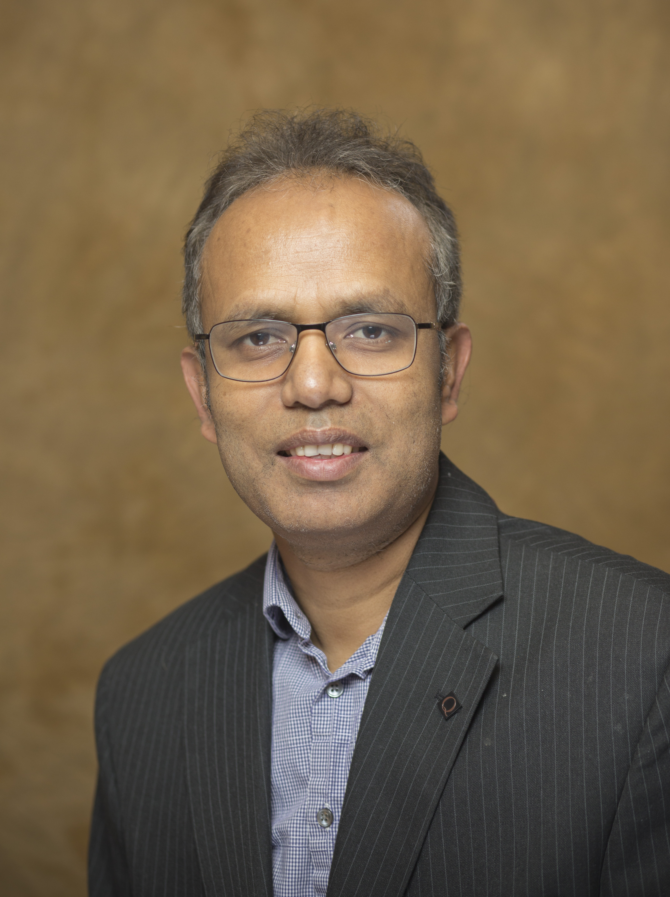
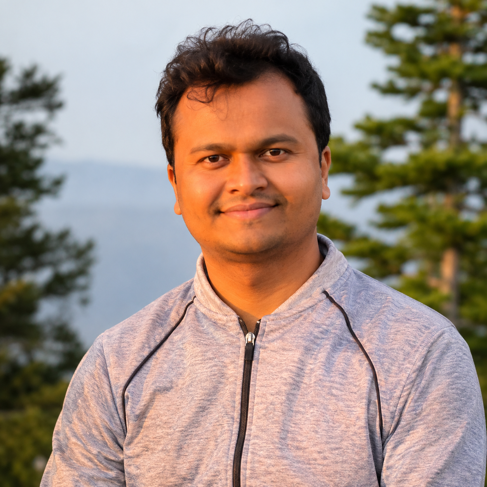
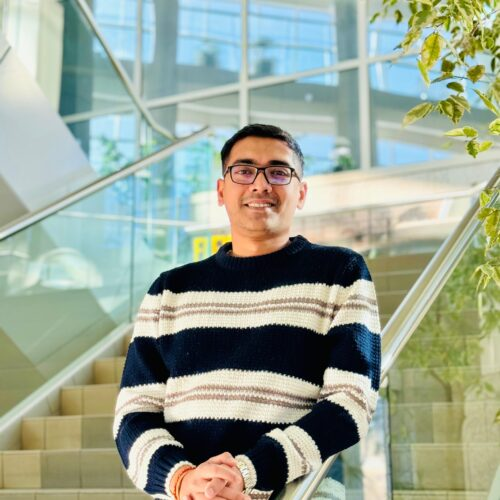

<link rel="stylesheet" href="/assets/css/research.css">

  <!-- ======================================================
       RESEARCH INTRODUCTION
       ====================================================== -->

  

    
      <i class="fa-solid fa-flask"></i>
      RESEARCH
    

    <h2>Research Interests and Collaborations</h2>

    

      My research lies at the intersection of
      <strong>Software Engineering and Artificial Intelligence</strong>,
      with a focus on empirical software engineering,
      human-centered software development, and trustworthy
      AI-assisted software engineering.
    

    

      I investigate how software development practices
      can become more effective, understandable, and
      trustworthy, particularly as AI coding agents
      increasingly participate in software development.
    

  

  <!-- ======================================================
       CURRENT RESEARCH PROJECTS
       ====================================================== -->

  <section class="research-section" id="projects">

    <h2>
      <i class="fa-solid fa-diagram-project"></i>
      Current Research Projects
    </h2>

    

      <!-- Project 1 -->
      

        

          Research Direction
        

        <h3>Engineering Trustworthy AI-Generated Software</h3>

        

          Investigating how AI-generated software can be
          systematically evaluated for correctness,
          maintainability, security, and long-term
          software quality.
        

        

          AI-Generated Code
          Software Quality
          Trustworthy AI
        

      

      <!-- Project 2 -->
      

        

          Research Direction
        

        <h3>Human–AI Collaboration in Code Review</h3>

        

          Understanding how developers evaluate,
          verify, and make acceptance decisions
          about AI-authored pull requests,
          including trust, verification effort,
          and review practices.
        

        

          Code Review
          Human–AI Collaboration
          Developer Experience
        

      

      <!-- Project 3 -->
      

        

          Research Direction
        

        <h3>Context-Aware Code Review and Quality Assurance</h3>

        

          Exploring how changes to software systems
          may introduce risks beyond modified files,
          and developing approaches to identify
          additional files and dependencies that
          reviewers should examine.
        

        

          Program Comprehension
          Code Review
          Risk Analysis
        

      

    

  </section>

  <!-- ======================================================
       RESEARCH COLLABORATORS
       ====================================================== -->

  <section class="research-section" id="collaborators">

    <h2>
      <i class="fa-solid fa-users"></i>
      Research Collaborators
    </h2>

    

      I have had the opportunity to collaborate
      with researchers working in software engineering,
      artificial intelligence, program comprehension,
      and related areas.
    

    <!-- ==================================================
         CURRENT COLLABORATORS
         ================================================== -->

    <h3 class="research-subheading">
      Current Collaborators
    </h3>

    

     <!-- Foutse Khomh -->
      

        

        <h3>Prof. Foutse Khomh</h3>

        

          Polytechnique Montréal
        

        <a
          href="https://www.khomh.net/"
          target="_blank"
          rel="noopener noreferrer"
          class="research-profile-link"
        >
          <i class="fa-solid fa-arrow-up-right-from-square"></i>
          Website
        </a>

      

      <!-- Chanchal K. Roy -->
      

        

        <h3>Prof. Chanchal K. Roy</h3>

        

          University of Saskatchewan
        

        <a
          href="https://www.cs.usask.ca/faculty/croy/"
          target="_blank"
          rel="noopener noreferrer"
          class="research-profile-link"
        >
          <i class="fa-solid fa-arrow-up-right-from-square"></i>
          Website
        </a>

      

      <!-- Zadia Codabux -->
      

        

        <h3>Dr. Zadia Codabux</h3>

        

          University of Saskatchewan
        

        <a
          href="https://www.cs.usask.ca/faculty/zadiacodabux/"
          target="_blank"
          rel="noopener noreferrer"
          class="research-profile-link"
        >
          <i class="fa-solid fa-arrow-up-right-from-square"></i>
          Website
        </a>

      

      <!-- Khairul Alam -->
      

        

        <h3>Khairul Alam</h3>

        

          University of Saskatchewan
        

        <a
          href="https://www.linkedin.com/in/khairul-alam-3563b1285/"
          target="_blank"
          rel="noopener noreferrer"
          class="research-profile-link"
        >
          <i class="fa-solid fa-arrow-up-right-from-square"></i>
          Website
        </a>

      

      <!-- Aronya Biraj Saha -->
      

        

        <h3>Aronya Biraj Saha</h3>

        

          University of Saskatchewan
        

        <a
          href="https://www.linkedin.com/in/biraj-saha-aronya-038499176/"
          target="_blank"
          rel="noopener noreferrer"
          class="research-profile-link"
        >
          <i class="fa-solid fa-arrow-up-right-from-square"></i>
          Website
        </a>

      

    

    <!-- END CURRENT COLLABORATORS -->

    <!-- ==================================================
         PAST COLLABORATORS
         ================================================== -->

    <h3 class="research-subheading">
      Past Collaborators
    </h3>

    

      <!-- Md Mustakim Billah -->
      

        

        <h3>Md Mustakim Billah</h3>

        

          Software Developer @Vendasta
        

        <a
          href="https://www.linkedin.com/in/mustakim-billah35/"
          target="_blank"
          rel="noopener noreferrer"
          class="research-profile-link"
        >
          <i class="fa-solid fa-arrow-up-right-from-square"></i>
          Website
        </a>

      

    

    <!-- END PAST COLLABORATORS -->

  </section>
  <!-- END RESEARCH COLLABORATORS -->

<!-- END RESEARCH PAGE -->
